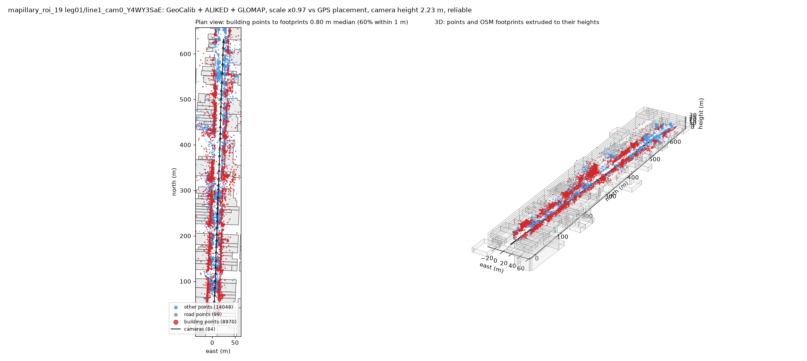
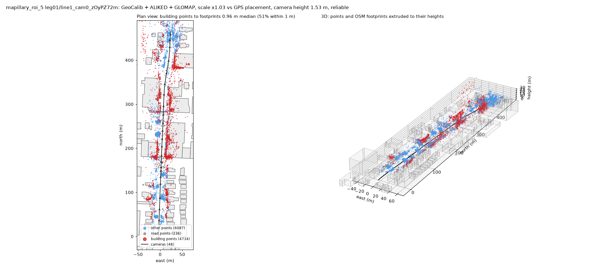
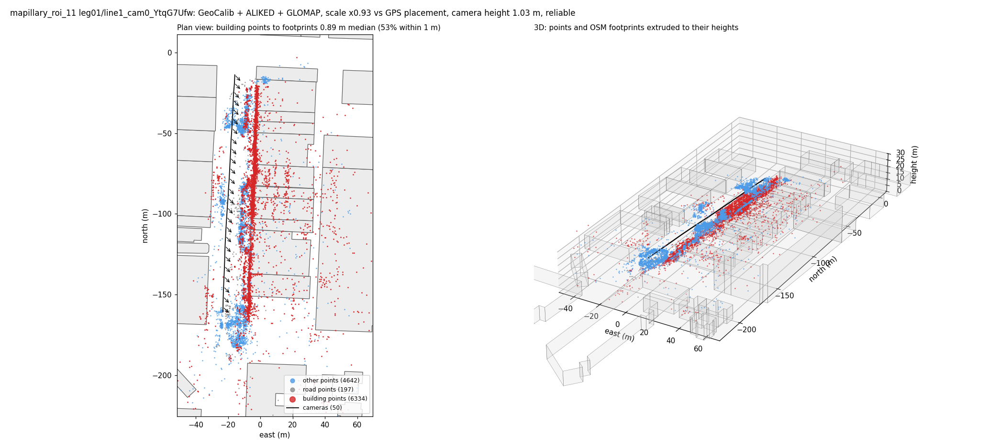
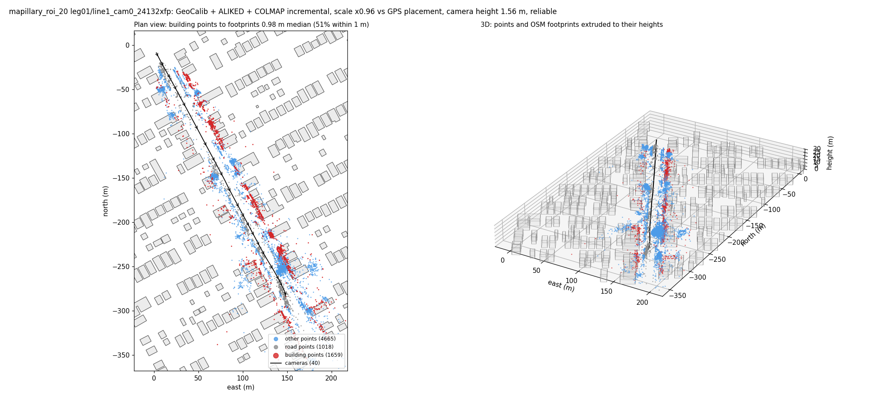

# Alignment Pipeline

Places Mapillary street-view cameras, and a sparse point cloud of the street, on
OpenStreetMap. You draw the streets on a map; the pipeline fetches the imagery, segments
buildings and roads, calibrates the camera with GeoCalib, reconstructs each stretch with
COLMAP, and fits the reconstructed building points onto the OSM building footprints. GPS is
used only as a starting point.

Raw Mapillary GPS is typically 5–20 m off. After alignment, the building points of a
reliable leg typically sit 0.5–1 m (median) from the OSM footprint edges.

## Stages

| # | Stage | Script | Output (in the ROI folder) |
|---|-------|--------|--------|
| 1 | gui | `route_gui.py` | the drawn route (`routes/*.json`) |
| 2 | mapillary | `mapillary_layer.py` | `data/mapillary/`: frames and `cameras.json` per sequence, `roi.json`, `sequences.json` |
| 3 | segmentation | `segmentation_layer.py` | `data/masks/`: building/road/sky-and-moving mask per frame |
| 4 | calibrate | `calibrate.py` | `data/calibration/<sequence>.json`: focal, distortion, per-frame gravity |
| 5 | reconstruct | `reconstruct.py` | `data/reconstruction/`: COLMAP model per leg and sequence, `legs.json` |
| 6 | align | `align.py` | `data/alignment/`: aligned cameras per sequence, `summary.json`; figures in `results/` |

`run_pipeline.py` runs them in order from any stage. Helpers: `common.py` (geography, ROI
folders, COLMAP readers), `osm.py` (OSM buildings), `learned_features.py` and `nn_features.py`
(feature matching), `plot_fit.py` (figures). Tools: `shape_check.py` (how straight and
drift-free each reconstruction is) and `export_blender.py` (scene for Blender).

## Running

```bash
cd Alignment_Pipeline
export MAPILLARY_TOKEN='MLY|...'                                 # for the mapillary stage
../.venv/bin/python run_pipeline.py                              # draw a route, run everything
../.venv/bin/python run_pipeline.py --roi routes/my_route.json   # reuse a drawn route
../.venv/bin/python run_pipeline.py --roi-dir rois/mapillary_roi_19            # resume where it stopped
../.venv/bin/python run_pipeline.py --roi-dir rois/mapillary_roi_19 --from reconstruct --one-leg --blender
../.venv/bin/python run_pipeline.py --roi-dir rois/mapillary_roi_19 --from reconstruct --tag test
```

- **`--from` / `--to`**: first and last stage. The default starts a new ROI at the GUI, or
  an existing one (`--roi-dir`) at its first unfinished stage.
- **`--one-leg`**: the whole route as one reconstruction (no splits at turns or by length).
  Better on long straight streets: on roi_19 (650 m) four separate legs each fitted the
  walls but landed 19–45 m apart at their junctions; one leg aligned all 84 frames at
  1.00 m.
- **`--max-frames`** (default 60), **`--max-turn`** (35°): where legs are split otherwise.
- **`--split-weak`**: drop weakly anchored frames and fit each side of the gap separately
  (off by default; see the reconstruct stage).
- **`--matcher`**: `auto` (default) picks nearest-neighbour matching for frames under 6 m
  apart and LightGlue otherwise; `nn` or `lightglue` forces one.
- **`--tag t`**: a separate run of reconstruct and align (`data/reconstruction_t`,
  `data/alignment_t`, `results/t`); the calibration is shared.
- **`--blender`**: also export the aligned cameras for Blender (see below).
- The mapillary stage always writes a new `rois/mapillary_roi_N` folder; `--view right`
  prefers cameras looking right, `--sequence ID` forces a sequence, `--no-rig` skips the
  rig's other cameras.

Every stage script also runs on its own (`python <script> --help` lists its options), e.g.
`python reconstruct.py rois/mapillary_roi_19 --max-turn 180 --trim-deg 180 --max-frames 200`.

## 1. Draw the route (`route_gui.py`)

Opens a map in your browser. Click along the streets you want; turns are fine. **New
street** starts a separate line. The corridor half-width must cover your clicking error but
not reach parallel streets (15 m works for most roads). **Use this route** saves it.

## 2. Fetch the imagery (`mapillary_layer.py`)

Mapillary is searched in small tiles along each line (a large query returns only a sample).
360° images and images outside the corridor are dropped. Each sequence (one capture session
of one camera) is split into continuous runs, and the best run is picked:

1. enough frames along its longest straight stretch;
2. frames dense enough to reconstruct: median spacing at most 10 m (`--max-spacing`);
3. the largest share of the drawn line (in 25% steps);
4. the densest spacing, then the most frames.

Rig siblings (vehicles with several cameras upload one sequence per camera) are added.
Frames are saved as `data/mapillary/line<L>_cam<k>_<id>/frame_0001.jpg …` with
`cameras.json` (Mapillary id, time, raw GPS, Mapillary's computed position and rotation,
compass, make, model, calibration). About 10 s per 100 frames.

## 3. Segment (`segmentation_layer.py`)

Mask2Former (Swin-Large, Mapillary Vistas) labels every pixel, reduced to four values per
mask: 0 other, 100 road, 200 building, 255 sky and moving things. About 0.3 s per frame on
an Apple-silicon GPU. `--previews` saves colour overlays.

## 4. Calibrate (`calibrate.py`)

GeoCalib (ECCV 2024) estimates the camera from single images:

- **Calibration:** about 20 frames spread over each sequence; the median focal length and
  distortion become the sequence's camera.
- **Gravity:** every frame, with the focal fixed to that median, for its roll, pitch and up
  direction. It agrees with the reconstructions to about 0.5–1°.

Mapillary's own calibration is not used: it is sometimes far off (roi_15's iPhone reports
1.34 of the image width against about 0.8), and starting phones from it did not help.
The reconstruct stage warns when Mapillary's focal differs from GeoCalib's by more than 10%.
About 0.8 s per frame; the result is reused by later runs.

## 5. Reconstruct (`reconstruct.py`)

**Legs.** Each line's capture is split at turns over 35° (frames in the corner trimmed) and
into chunks of at most 60 frames; rig cameras get the frames in each leg's time window.

Per leg and camera:

1. **Feature masks:** burned-in overlays (timestamps, bonnets) and the segmentation's sky,
   vehicles and people.
2. **Camera:** one per sequence from GeoCalib's focal. Strongly distorted lenses (GeoCalib
   k1 below −0.2, e.g. action cameras) use COLMAP's `RADIAL_FISHEYE` model, others
   `RADIAL`. Bundle adjustment refines it.
3. **Features:** ALIKED keypoints, each frame matched with its next 10:
   - frames under 6 m apart: mutual nearest neighbour of the descriptors (`nn_features.py`),
     2–6 s per leg;
   - 6 m and over: LightGlue (`learned_features.py`), about 15× slower. With
     nearest-neighbour, sequences 8–10 m apart (roi_4, 5, 9, 19) reconstructed unstably
     (bent, crushed or lost frames).
4. **Gravity priors:** GeoCalib's down direction per frame goes into COLMAP's pose priors
   (no positions: GPS is not used).
5. **COLMAP 4.2 `global_mapper`** (GLOMAP) with gravity-aided rotation averaging, then
   `point_triangulator` re-triangulates every match with the poses fixed (more road and
   building points).
   - **Fallback:** if any camera lands behind an earlier one along the leg, the leg is solved
     again with COLMAP's incremental mapper on the same matches, and kept if it holds capture
     order. GLOMAP sets all rotations at once from frame-pair rotations; where a few pairs agree
     on a wrong rotation (a parked truck filling the view on roi_11, a skipped frame on roi_20)
     it turns those cameras and slides a stretch back over the previous one. No seed or outlier
     setting avoided it, while the incremental mapper kept both in order. Elsewhere GLOMAP is
     as good or better (roi_10, roi_5), so it stays first. `--mapper incremental` forces it.
6. **Weak frames (off by default, `--split-weak`):** frames left with under 0.35× the leg's
   median number of 3D points (e.g. a parked truck filling the view) are dropped and the leg
   solved again, and the alignment fits each side of the gap separately. It fixed roi_11's
   truck leg, but on roi_20 the two sides ended 72 m apart where Mapillary has 41 m, so it
   isn't trusted by default yet.

## 6. Align to OSM (`align.py`)

Per leg and camera:

1. **Level** the model with GeoCalib's gravity.
2. **Ground:** median height of the road points near the path.
3. **Building points:** labelled Building, seen in 3+ frames, 2.5–40 m up, thinned to one
   per 0.5 m.
4. **Fit:** one 2D similarity (heading, scale, position) placing the building points as close
   as possible to the OSM footprint edges: a global search around Mapillary's positions,
   then a robust refinement. Every building point counts, including side walls, corners and
   gaps, which is what pins the position along the street. GPS gives the starting placement
   and weak priors only.
5. **Pieces (only with `--split-weak`):** where weak frames were dropped, each side of the
   gap gets its own fit; the output is still one leg.
6. **Reliable** when the building points end within 2 m (median, `--max-error`) of the
   footprints, at most 20% of the cameras end inside buildings, and no camera lies behind an
   earlier one along the leg (a folded reconstruction can still fit its walls).

Outputs:

| Path | Contents |
|---|---|
| `data/alignment/<sequence>.json` | aligned cameras: lon, lat, height, heading, pitch, roll, reliable |
| `data/alignment/<leg>_<sequence>/` | `stats.json`, `transform.json`, `plan.png` (GPS placement vs fitted) |
| `data/alignment/summary.json` | frames aligned and reliable, per-leg fit |
| `results/overview.png` | all aligned cameras on the map (blue reliable, red unreliable) |
| `results/fit_<leg>_<sequence>.png` | the leg's point cloud on the footprints, plan and 3D |

Fitting the whole point cloud replaced fitting extracted facade lines to street-facing
walls: against a three-pass reference on roi_17, single passes came out 1.9–7.7 m away
instead of 9–14 m, and failures are reported as unreliable instead of passing.

## Checking and exporting

- `python shape_check.py <roi> [--tag t]`: per leg, how far the camera path bends compared
  with Mapillary's track, how well each camera's tilt agrees with GeoCalib's gravity, and
  the scale drift from the start to the end of the leg. Use it alongside the fit: a bent or
  crushed reconstruction can still fit its walls.
- `python export_blender.py <roi> [--tag t]` (or `--blender`): writes `results/blender/`
  with the aligned cameras (photos undistorted to a pinhole), Mapillary's GPS cameras and
  the sparse points. In Blender, run the repo root's `compare_cameras_blender.py` with
  `SCENE_DIR` set to that folder and `LOAD = ("pipeline", "gps", "points")`. Camera heights
  are measured from the road under the path, so streets that climb or dip sit flat.

## Results so far

| ROI | Camera | Frames reliable | Building points to footprints |
|---|---|---|---|
| roi_2 | iPhone | 28/30 | 0.94 m |
| roi_4 | iPhone, 8.6 m apart | 30/30 | 1.14 m |
| roi_5 | iPhone, 9.9 m apart | 43/48 | 1.20 m |
| roi_7 | iPhone, 2 legs | 36/37 | 0.71 / 1.05 m |
| roi_8 | iPhone | 22/23 | 0.58 m |
| roi_11 | motorcycle rig, 2 cameras | 79/131 | 0.85–0.94 m; one leg at a construction site that doesn't match OSM |
| roi_19 | iPhone, 650 m, one leg | 84/84 | 1.00 m |
| main_street_east | motorcycle | 33/33 | 0.74 m |
| roi_9 | iPhone, forward, 10 m apart, buildings far back | 0/33 | 3.2 m |

### Example fits

Each image shows one camera's reconstruction after alignment. On the left is a plan view:
building points (red), other points (blue) and road points (grey) over the OSM footprints,
with the camera path in black. On the right is the same in 3D against the footprints
extruded to their OSM heights.

**roi_19:** iPhone, 650 m processed as one leg, 84 frames. 0.80 m median to the footprints.


**roi_5:** iPhone, frames 9.9 m apart, 48 frames. 0.96 m median.


**roi_11, leg 1:** motorcycle rig, 50 frames. 0.89 m median.


**roi_20:** GLOMAP put two cameras behind earlier ones, so the pipeline switched to the
incremental mapper. 40 frames, 0.98 m median.


Typical time for 80–100 frames: about 5 minutes (GeoCalib 1 min, LightGlue matching 2.5
min when used, COLMAP 0.5 min, alignment 0.3 min).

## Limits

- A fit per leg cannot undo drift within the leg (a reconstruction that shrinks or bends
  along the street); measured drift on roi_19's 650 m leg was about 7%.
- Forward-facing cameras with widely spaced frames and buildings set far back (roi_9)
  reconstruct poorly.
- Scenes that don't match OSM (construction sites, fences, open frames) stay unreliable.
- Several captures of the same street are not combined.

## Setup

1. Python 3.10+ and the packages (`requirements.txt`):
   ```bash
   python -m venv .venv && source .venv/bin/activate
   pip install -r requirements.txt
   ```
   First runs download the Mask2Former (about 900 MB), GeoCalib, ALIKED and LightGlue
   weights.
2. COLMAP 4.2 or newer on the PATH (`brew install colmap` on macOS).
3. A Mapillary client access token from https://www.mapillary.com/dashboard/developers,
   set as `MAPILLARY_TOKEN`. Do not commit it.

OSM buildings come from the public Overpass API (or the main OSM API when Overpass is down)
and are saved per ROI. No keys are needed for OSM or the GUI's basemaps.

## Data layout

```
routes/                               drawn routes (route_gui.py)
logs/                                 run logs
benchmarks/                           earlier comparisons (facade vs points, SIFT vs LightGlue, GLOMAP)
rois/
  mapillary_roi_N/
    data/
      mapillary/    roi.json  sequences.json  line1_cam0_<id>/{frame_0001.jpg ..., cameras.json}
      masks/        classes.json  line1_cam0_<id>/frame_0001.png ...
      calibration/  line1_cam0_<id>.json
      reconstruction/  legs.json  leg01/line1_cam0_<id>/{sparse/0/txt, colmap.log, ...}
      alignment/    line1_cam0_<id>.json  summary.json  osm_buildings.json  leg01_line1_cam0_<id>/
      reconstruction_<tag>/  alignment_<tag>/      tagged runs
      old/          results of earlier pipeline versions (kept, not used)
    results/
      overview.png  fit_leg01_line1_cam0_<id>.png  blender/  <tag>/  old/
```
