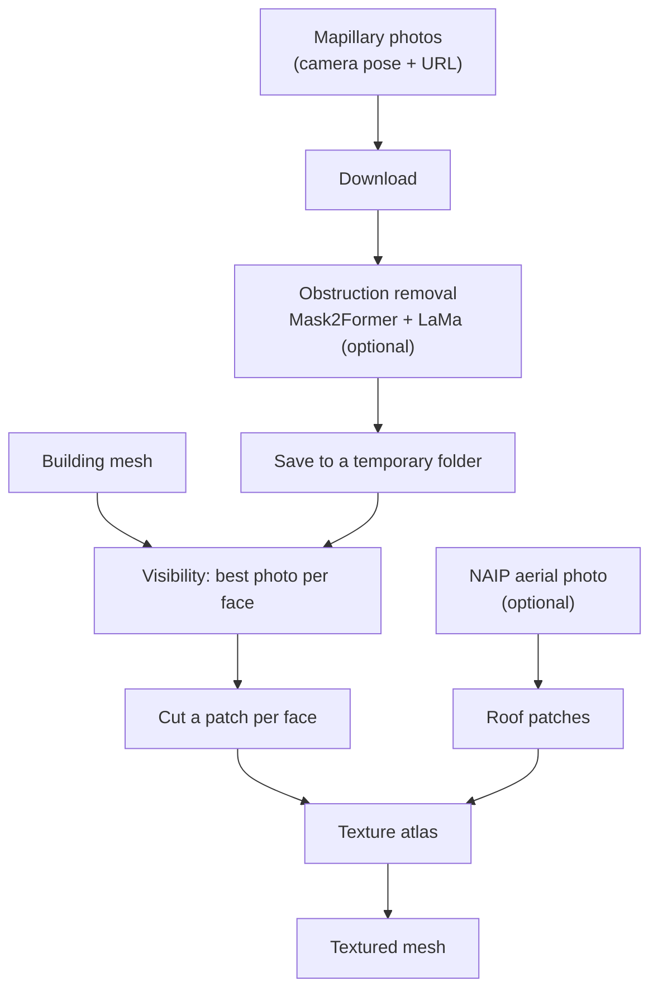

import AtlasDiagram from '@site/src/components/AtlasDiagram';

# Texturing

The **Texture** stage (`texturing`, `src/texturing/tex_projection.py`) maps the Mapillary street photos onto the building walls and, with aerial photos on, the NAIP image onto the roofs. Everything is packed into one texture atlas.



## 1. Download and clean the photos

Every Mapillary image with a usable pose (rotation, focal length and size) is downloaded. With obstruction removal on (the default; `--no-seg` turns it off), each photo goes through Mask2Former and LaMa first (see below).

Photos aren't kept in memory: each one is written to a temporary folder, losslessly (the downloaded file as is, or a PNG once obstruction removal has changed it), and read back when it's needed. The web app also saves small previews of the first 12 photos for its **Street imagery** section.

## 2. Pick the best photo for each face

Each photo's camera is rebuilt from its metadata:

- position: from its GPS location, converted to UTM, **1.6 m** above the ground (above the terrain when there is one);
- rotation: from Mapillary's computed rotation;
- intrinsics: a pinhole camera with the focal length in pixels and the principal point at the image centre:

```
K = [[f,  0,  w/2],
     [0,  f,  h/2],
     [0,  0,  1  ]]
```

For every face and every photo, the face is a candidate if:

1. **it faces the camera** (its normal points towards it);
2. **it's in front of the camera** (all three corners at positive depth);
3. **it's inside the image** (all three projected corners within the photo);
4. **nothing is in the way**: a ray from the camera to the face's centre doesn't hit another face first.

Each face gets the candidate that sees it most **head-on**. With aerial photos on, roof faces are left to the NAIP image instead.

## 3. Cut the patches

For each assigned face, a 2D frame is built on the face, a homography maps it to the photo, and `cv2.warpPerspective` cuts out a rectangular patch. Patch size follows the face's size in metres, up to **1024 px** per side. Photos are read back from the temporary folder one at a time, grouped by photo.

## 4. Build the atlas

All patches (street and roof) are packed into one atlas **4096 px** wide, row by row, left to right. A 16 px strip at the bottom holds the colour for faces no photo covers: a light grey (225 of 255). The atlas becomes the mesh's base-colour texture (a double-sided `PBRMaterial`).

<AtlasDiagram />

## Obstruction removal

`src/segmentation/obstruction.py`:

1. **Mask2Former** labels every pixel (`src/segmentation/model.py`). The default checkpoint is `facebook/mask2former-swin-large-mapillary-vistas-semantic`: trained on Mapillary Vistas, 25,000 crowdsourced Mapillary photos from many cameras and countries with 65 classes. The web app's Swin-Tiny option is a Cityscapes checkpoint (19 classes; Vistas has no Tiny), and the CLI reads `SEG_MODEL`. The model loads once and stays loaded, on the GPU when there is one (or `SEG_DEVICE`).
2. The **obstruction classes** below, matched by name so either kind of checkpoint works, are combined into one mask, which is dilated by 15 px to cover their edges.
3. **LaMa** fills the masked areas with plausible facade. It works on a copy scaled down to at most 1024 px on the long side, and only the masked pixels are replaced in the full-size photo.

| Kind                | Mapillary Vistas classes                                                                                                   | Cityscapes classes                       |
| ------------------- | -------------------------------------------------------------------------------------------------------------------------- | ---------------------------------------- |
| Poles and signs     | Pole, Utility Pole, Street Light, Traffic Light, Traffic Sign (Front), Traffic Sign (Back), Traffic Sign Frame             | pole, traffic light, traffic sign        |
| Vegetation          | Vegetation                                                                                                                 | vegetation                               |
| People and animals  | Person, Bicyclist, Motorcyclist, Other Rider, Bird, Ground Animal                                                          | person, rider                            |
| Vehicles            | Car, Truck, Bus, On Rails, Motorcycle, Bicycle, Boat, Caravan, Other Vehicle, Trailer, Wheeled Slow                        | car, truck, bus, train, motorcycle, bicycle |
| The capture vehicle | Ego Vehicle, Car Mount                                                                                                     | (no such classes)                        |

With `--poses colmap`, the photos the pose alignment downloaded and segmented (with the same Vistas checkpoint) are reused: texturing neither downloads nor segments them again.

:::tip[Faster runs]

`--no-seg` (or turning off **Remove obstructions** in the web app) skips this step entirely. Swin-Tiny is a middle ground on a CPU.

:::

## Runtime

These numbers were measured for **Design Review 1**, on an older version of the pipeline. Texturing was then about **93 %** of the total wall time:

| Component                        | Wall Time   | CPU %   |
| -------------------------------- | ----------- | ------- |
| Image download + segmentation    | ~150 s      | varies  |
| Visibility analysis + projection | ~230 s      | 76 %    |
| Atlas construction               | < 1 s       | --      |
| **Total texturing stage**        | **~6m 18s** | **76 %** |

Peak memory was about 12.4 GB of RAM and 1.06 GB of GPU memory. Since then, photos are kept on disk instead of in memory, which lowers peak RAM.

## Source code

- `src/texturing/tex_projection.py`: `tex_projection()` (the stage), `apply_textures()`, camera math, atlas packing
- `src/segmentation/obstruction.py`: `remove_obstructions()`, `build_obstruction_mask()`, `synthesize_texture()`
- `src/naip/naip.py`: `roof_faces()`, `roof_patches()`
