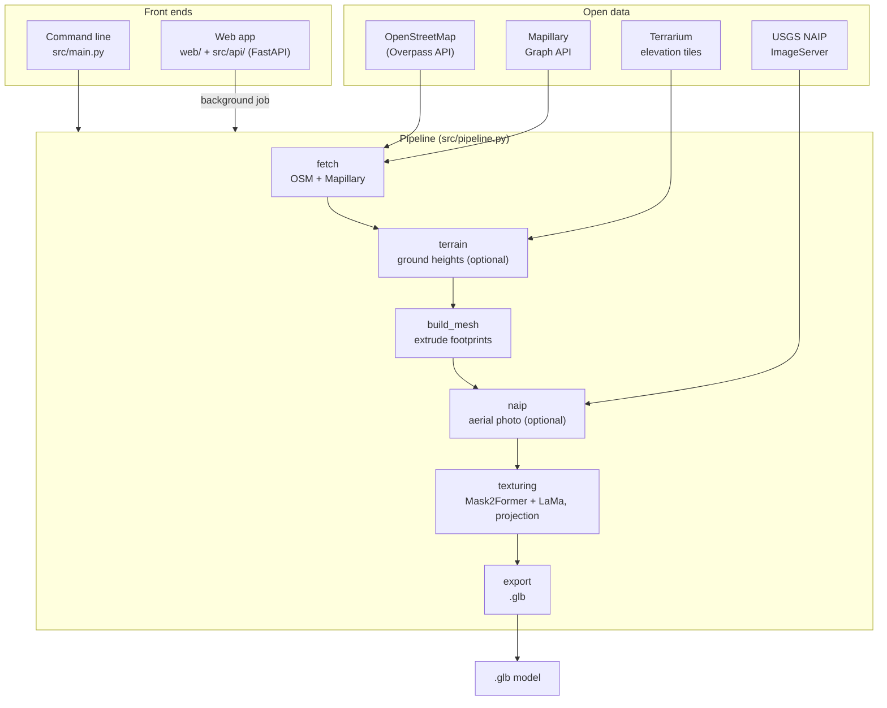
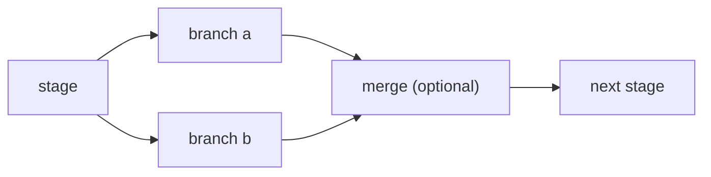
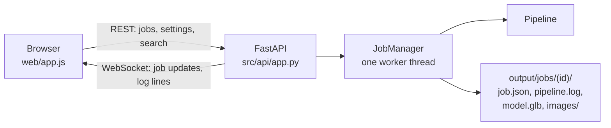

# System Architecture

PSM is one pipeline with two front ends. The pipeline itself (`src/pipeline.py`) is a chain of stages built on a small `PipelineChain` framework. The command line (`src/main.py`) and the web app (`src/api/`) both run that same chain; they differ only in how they collect the options and where the output goes.

## Overview



## Technology Stack

| Layer            | Technology                                                                | Role                                                                                 |
| ---------------- | ------------------------------------------------------------------------- | ------------------------------------------------------------------------------------ |
| **Data**         | OpenStreetMap (Overpass), Mapillary Graph API, Terrarium tiles, USGS NAIP | Building footprints, street photos with camera poses, ground heights, aerial photos |
| **Segmentation** | Mask2Former (Cityscapes semantic; Swin-Large or Swin-Tiny)                | Find obstructions (cars, people, poles, vegetation, ...) in street photos            |
| **Inpainting**   | LaMa (`simple-lama-inpainting`)                                           | Fill the obstruction masks with plausible facade                                     |
| **Mesh**         | Trimesh, Shapely, `mapbox-earcut`                                         | Extrude footprints, triangulate roofs and floors, build the scene, export `.glb`    |
| **Vision**       | OpenCV, Pillow, NumPy, SciPy                                              | Camera projection, homography warps, atlas packing, roof alignment                   |
| **Coordinates**  | PyProj                                                                    | WGS84 ↔ UTM for metre-scale geometry                                                 |
| **Web backend**  | FastAPI, Uvicorn, WebSockets                                              | Jobs, live progress and logs, settings, address search                               |
| **Web frontend** | Plain HTML/CSS/JS, Leaflet, three.js                                      | Area picking on an OSM map, 3D preview                                               |
| **Packaging**    | Docker (CPU and CUDA images), Docker Compose                              | One-command setup on Linux, macOS (Intel and Apple Silicon) and Windows             |
| **Profiling**    | `PipelineProfiler`                                                        | Per-stage wall time, CPU time, peak memory, GPU memory                               |

## Pipeline framework

The framework is in `src/common/pipeline_chain.py`:

- **`PipelineChain`** is an ordered list of stages. Each stage is a callable `(value, state) -> value`: it gets the previous stage's output and returns its own. Stages also have a **label** and **detail**, which the web app shows on its timeline.
- **`PipelineState`** carries everything else through the run: the outputs of finished stages and a metadata dictionary (the bounding box, options such as `remove_obstructions` or `use_terrain`, the reporter, ...).

`build_pipeline()` in `src/pipeline.py` defines the stages, so a stage added there shows up in the CLI and on the web timeline automatically:

```python
pipeline = PipelineChain("photorealistic-street-maps")
pipeline.add_stage("fetch", ingest_data, label="Fetch data", detail="OSM + Mapillary")
pipeline.add_stage("terrain", terrain_stage, label="Terrain", ...)
pipeline.add_stage("build_mesh", build_mesh, label="Build mesh", ...)
pipeline.add_stage("naip", naip_stage, label="Aerial photo", ...)
pipeline.add_stage("texturing", tex_projection, label="Texture", ...)
pipeline.add_stage("export", export_mesh, label="Export", detail="Write .glb")
```

Stages don't have to form a single line. A **fork** (`add_fork`) sends one stage's output to several branches: each branch gets the same input, and they run one after another (not in parallel). An optional merge function combines their outputs into the value the next stage receives; without one, the next stage gets a dict of the branch outputs keyed by branch name. Each branch's output is also kept in `state.stage_outputs` under its name.



The framework can also resume a run from a named stage, call an `on_stage` callback as each stage starts, finishes or fails (the web app uses it to update the timeline), and profile each stage.

## Reporting output

Pipeline code never calls `print()` or `tqdm` directly. It asks for a **reporter** with `get_reporter(state)` and calls `info()`, `warning()`, `error()` or `progress()`:

- On the command line, the default reporter prints to the console with tqdm progress bars.
- The web app passes a `JobReporter` that writes each line to the job's `pipeline.log`, streams it to the browser over a WebSocket, and echoes it to the server console.

The Mapillary token is scrubbed from log lines and error messages before they are written anywhere.

## Web app



- Jobs run one at a time on a single worker thread, since the segmentation and inpainting models are large. Each job's files live in its own folder, so finished jobs survive a restart.
- Every change to a job (status, stage) and every log line is pushed to connected browsers over `/api/ws`.
- See [Web API](api/web.md) for the endpoints.

## Coordinate systems

- **WGS84 (lat/lon)**: the input bounding box and the OSM/Mapillary data.
- **UTM (metres)**: all geometry is built in the UTM zone of the area's centre, so distances are in metres. Building meshes are built with Z pointing down (roofs at negative Z).
- **Model space**: the export moves the model to the origin, flips Z to point up, and rotates it −90° about X to glTF's Y-up convention.

## Key design decisions

**Open data only.** OpenStreetMap, Mapillary, Terrarium and NAIP are all open or public domain; no proprietary APIs or paid datasets.

**One pipeline, two front ends.** The CLI and the web app share `build_pipeline()`, so a stage change is reflected in both, including the web timeline.

**Optional extras stay optional.** Obstruction removal (`--no-seg`), terrain (`--terrain`) and aerial photos (`--naip`) can be turned off, and the optional stages fall back to the simpler result if their download fails.

**Atlas-based texturing.** All facade (and roof) textures are packed into one texture atlas, so the `.glb` is self-contained and opens in standard viewers.
