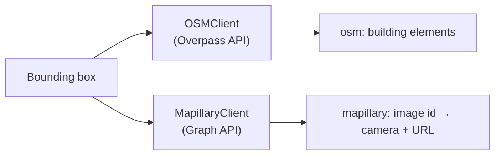

# Data Processing

The **Fetch data** stage (`fetch`, `src/data_ingest/ingest.py`) downloads everything the later stages need for the bounding box: building footprints from OpenStreetMap and street photos with camera poses from Mapillary. Its output is `{"osm": ..., "mapillary": ...}`, which it also stores in the state as `provider_data`.

## OpenStreetMap

`OSMClient` (`src/common/providers/osm.py`) asks the Overpass API for every element tagged `building` in the bounding box, with its geometry and tags. Overpass returns whole buildings, including ones that only cross the box's edge.

The public Overpass servers are often busy, so the client tries several:

- `overpass-api.de`, then the public mirrors `overpass.private.coffee` and `overpass.kumi.systems`;
- up to 3 rounds over all of them, waiting 5 s, then 10 s, between rounds;
- busy or failing responses (HTTP 429, 500, 502, 503, 504), connection errors and timeouts move on to the next server.

Each building element has:

- **geometry**: the footprint's lat/lon vertices
- **id**: the OSM way/relation id
- **tags**: including `height` and `building:levels`, which give the building height (see [Mesh Generation](mesh-generation.md))

:::warning OSM data quality

OSM heights are community-contributed and often missing. Buildings without a `height` or `building:levels` tag get a default height of 3 m.

:::

## Mapillary

`MapillaryClient` (`src/common/providers/mapillary.py`) fetches street-level photos and their camera metadata from the Mapillary Graph API. It needs `MAPILLARY_ACCESS_TOKEN` (see [Configuration](../configuration.md)).

A single bounding-box search can't be paged, and in dense areas Mapillary silently returns only part of the images even below the 2000-image limit. So the client:

- splits the area into tiles of about 50 m (0.0005°) and queries them in parallel (8 at a time);
- splits any tile that comes back with at least half the limit into quarters, up to 4 levels deep;
- retries failed requests, and merges the results by image id.

The fields requested are `id`, `thumb_original_url`, `sequence_id`, `geometry`, `computed_geometry`, `computed_compass_angle`, `computed_rotation`, `camera_parameters`, `width`, `height` and `quality_score`.

For each image the client keeps the camera position, the rotation (as a rotation vector, plus yaw/pitch/roll), the focal length in pixels (from `camera_parameters` and the image size), the image size, the photo URL and the quality score. Images without a computed rotation are skipped.

### Quality filter

`quality_score` is Mapillary's predicted image quality, from 0 to 1. With `--min-quality SCORE`, images scoring below `SCORE` are dropped; images without a score are kept. The score favours clear, wide street views, so a sharp close-up of a wall can score low. Use a low threshold (around 0.3) to drop blurry and night shots without losing useful facades.

## Source code

- `src/data_ingest/ingest.py`: the `fetch` stage
- `src/common/providers/osm.py`, `overpass.py`: OpenStreetMap
- `src/common/providers/mapillary.py`: Mapillary
