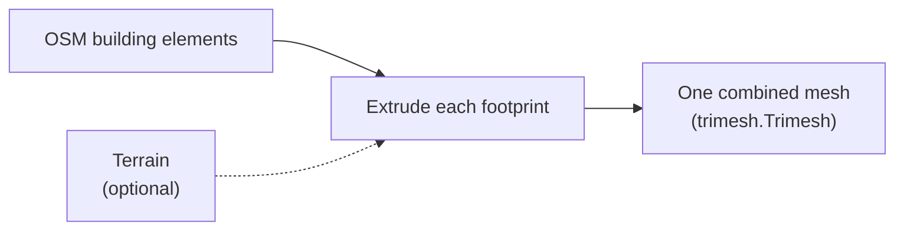

# Mesh Generation

The **Build mesh** stage (`build_mesh`, `src/mesh_builder/extrude.py`) turns each OpenStreetMap footprint into a 3D building and combines them into one mesh.

## How a building is made

For each element with a geometry:

1. **Corners**: its lat/lon vertices are converted to UTM metres (`get_corners()` in `src/common/MeshUtils.py`).
2. **Outline**: the corners become a closed Trimesh `Path2D`. Elements whose outline doesn't close are skipped.
3. **Height**: from the OSM tags (see below).
4. **Extrude**: `path.extrude(height)` builds the walls, roof and floor. Roofs and floors are triangulated with earcut (`mapbox-earcut`).

All buildings are then combined into one mesh with `trimesh.util.concatenate`.

## Height

Heights come from the OSM tags, in this order (`get_height()` in `src/common/MeshUtils.py`):

1. `height`: metres, used as is;
2. `building:levels`: 3 m per level;
3. otherwise 3 m (one level).

:::warning[Missing heights]

Many OSM buildings have neither tag, so they come out as 3 m boxes. Better height estimation is an open area of work.

:::

## Standing on the terrain

Without terrain, every building starts at ground level (zero). With terrain (see [Terrain & Aerial Photos](terrain-and-aerial.md)), the ground under each footprint is sampled on the terrain grid, inside the footprint and along its outline:

- the walls reach **0.1 m below the lowest** ground point, so the building never floats on a slope;
- the roof sits the building's height above the **highest** ground point, so it's never buried.

## Coordinates

Meshes are built in the area's UTM zone with **Z pointing down**: buildings are extruded to negative Z. The texturing and export stages flip Z back, and the export turns the model to glTF's Y-up convention (see [Pipeline Overview](overview.md#export)).

## Strengths and limitations

**Strengths**

- Fast: well under a second for hundreds of buildings.
- Footprints line up with the map and with aerial imagery.
- Deterministic, with no machine learning involved.

**Limitations**

- Simple prism shapes: flat roofs, no architectural detail.
- Heights are often missing or inaccurate in OSM.

## Extensions under exploration

Other approaches the team has looked at for more detailed buildings:

- **Structure from Motion (SfM)**: build point clouds from many Mapillary photos, then mesh them. More accurate shapes, but it needs a GPU and many more images.
- **VGGT** (Visual Geometry Grounded Transformer): predicts camera poses and 3D structure directly from a handful of images, producing a coloured point cloud of a building face.

## Source code

- `src/mesh_builder/extrude.py`: `build_mesh()`, `extrude_buildings()`, `ground_under()`
- `src/common/MeshUtils.py`: `get_corners()`, `get_lines()`, `get_height()`
