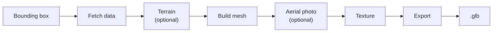

# Pipeline Overview

The POSM pipeline turns a geographic bounding box into a textured 3D model. It's a chain of six stages, defined in `build_pipeline()` in `src/pipeline.py` and shared by the command line and the web app.

## Stages

| Stage (name)                    | What it does                                                                                  | Output                                                    | Page                                                    |
| ------------------------------- | --------------------------------------------------------------------------------------------- | --------------------------------------------------------- | ------------------------------------------------------- |
| **Fetch data** (`fetch`)        | Building footprints from OpenStreetMap; street photos and camera poses from Mapillary.        | `{"osm": ..., "mapillary": ...}`                          | [Data Processing](data-processing.md)                   |
| **Terrain** (`terrain`)         | With `--terrain`: ground heights for the area. Otherwise passes the data through.            | the fetch output (the terrain goes in the state)          | [Terrain & Aerial Photos](terrain-and-aerial.md)        |
| **Build mesh** (`build_mesh`)   | Extrudes each footprint into a 3D building, standing on the terrain if there is one.          | one untextured `trimesh.Trimesh`                          | [Mesh Generation](mesh-generation.md)                   |
| **Aerial photo** (`naip`)       | With `--naip`: NAIP aerial photo for the ground and roofs. Otherwise passes the mesh through. | the mesh (the aerial photo goes in the state)             | [Terrain & Aerial Photos](terrain-and-aerial.md)        |
| **Texture** (`texturing`)       | Cleans the street photos and projects them onto the walls; packs a texture atlas.             | the textured mesh                                         | [Texturing](texturing.md)                               |
| **Export** (`export`)           | Moves the model to the origin, turns it to glTF's Y-up, adds the ground, writes the `.glb`.   | the mesh, or a scene with `buildings` and `terrain` nodes | below                                                   |

Each stage is a function `(value, state) -> value`. `value` is the previous stage's output; `state` (a `PipelineState`) gives access to the shared metadata below.

## Metadata

The front end puts these in the pipeline state before it runs:

| Key                   | Set by           | Used by                    | Meaning                                                                    |
| --------------------- | ---------------- | -------------------------- | -------------------------------------------------------------------------- |
| `bbox`                | CLI, web         | most stages                | the area (`BoundingBox`)                                                    |
| `progress_monitor`    | CLI, web         | all stages                 | step counter for the CLI's progress display                                 |
| `reporter`            | web              | all stages                 | where output goes (see [Reporter](../api/reporter.md)); the console if unset |
| `remove_obstructions` | CLI, web         | `texturing`                | run Mask2Former + LaMa (`--no-seg` turns it off)                            |
| `seg_model`           | web              | `texturing`                | Mask2Former checkpoint                                                      |
| `seg_device`          | web              | `texturing`                | `auto`, `cpu` or `cuda`                                                     |
| `use_terrain`         | CLI, web         | `terrain`                  | `--terrain` (also on with `--naip`)                                         |
| `use_naip`            | CLI, web         | `naip`                     | `--naip`                                                                    |
| `min_quality`         | CLI              | `fetch`                    | `--min-quality`                                                             |
| `output_path`         | CLI, web         | `export`                   | where to write the `.glb`                                                   |
| `ask_output_path`     | CLI              | `export`                   | opens a save dialog when there's no `output_path`                           |
| `mapillary_dump_path` | CLI              | `texturing`                | `--dump-mapillary`: write the raw Mapillary metadata here                   |
| `image_dir`           | web              | `texturing`                | where to save the photo previews the web app shows                          |

Stages add to it as they go: `provider_data` (fetch), `terrain` (terrain), `naip` (aerial photo).

## Export

The export stage:

1. moves the model so the area's centre (in UTM) is at the origin,
2. flips Z to point up (meshes are built Z-down),
3. with terrain, builds the ground mesh, drapes the aerial photo on it if there is one, and keeps it as a separate object (merging would drop the buildings' texture),
4. centres everything and rotates it −90° about X into glTF's Y-up convention,
5. writes the `.glb` (a scene with `buildings` and `terrain` nodes when there is terrain).

## Optional stages

`terrain` and `naip` are always in the chain, so the web timeline has a fixed list of stages. When they're off they return their input unchanged, and the web app shows them as **Skipped**. If their downloads fail, they log a warning and the pipeline continues with flat ground or plain roofs.

## Success criteria

The project's targets, from the design review:

| Metric             | Target                                                         |
| ------------------ | -------------------------------------------------------------- |
| Mesh generation    | Uncorrupted `.glb` file                                        |
| Texture generation | Textures derived from street-view images                       |
| Mesh quality       | Average user survey rating ≥ 8/10 on building shape realism   |
| Texture quality    | Average user survey rating ≥ 8/10 on building texture realism |
| Total runtime      | Less than 25 minutes per 247 acres                             |
| Usability          | Average user rating ≥ 7/10 on pipeline ease of use             |
